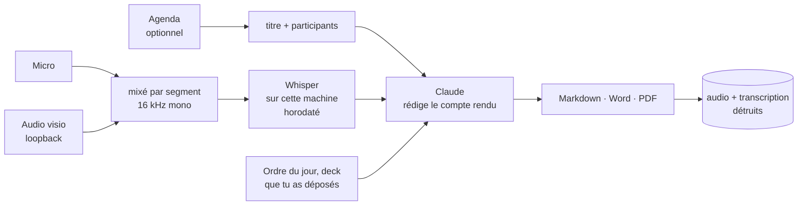

<h1 align="center">Mispy</h1>

<p align="center">
  <strong>Deux commandes. Tu as le compte rendu.</strong><br>
  <sub>Il enregistre la réunion, la transcrit sur ta machine, et rédige ce qui a
  été décidé et qui doit quoi à qui. <b>macOS et Windows.</b></sub>
</p>

<p align="center">
  <a href="#installation">Installation</a> ·
  <a href="#réglage-cinq-minutes-une-fois">Réglage</a> ·
  <a href="#une-réunion-de-bout-en-bout">Déroulé</a> ·
  <a href="#la-salle-la-visio-ou-les-deux">Visios</a> ·
  <a href="#au-bureau-sur-un-pc-verrouillé">Au bureau</a> ·
  <a href="#ce-qui-sort-de-ta-machine">Confidentialité</a> ·
  <a href="README.md">🇬🇧 In English</a>
</p>

<p align="center">
  
</p>

---

## L'idée

Tu peux être dans la réunion, ou tu peux prendre les notes. Faire correctement les
deux est un mythe, et celui qui prend les notes est celui qui arrête de contribuer.

```bash
mispy start        # au début
mispy stop         # à la fin
```

C'est toute l'interface. Mispy enregistre — la salle, la visio, ou les deux — et
quand tu l'arrêtes il transcrit l'audio **sur ta propre machine**, établit ce qui a
été décidé et qui s'est engagé à quoi, et écrit le tout dans ton dossier de
réunions : du Markdown à coller dans Slack ou un mail, un fichier Word à faire
suivre, un PDF à archiver. Tu choisis lesquels.

Ensuite il détruit l'enregistrement et la transcription.

---

## Ce que ça donne

Vraie sortie, sur une réunion inventée de trois minutes à propos d'une migration :

```markdown
# Retard migration, budget T4, recrutement

**08/10/2026 · 10:00–10:01 · 2 min**
**Présents :** Jacques Morel, Sandy Lefèvre, Eddy Bertin

## Décisions
- La reprise sera découpée en trois lots, exécutés les nuits du mardi
  au jeudi de la semaine suivante [00:00:26]
- Le contrat du deuxième prestataire sera arrêté fin novembre [00:01:09]

## Actions
| Qui   | Quoi                                              | Pour quand   |
|-------|---------------------------------------------------|--------------|
| Sandy | préparer le plan de bascule et l'envoyer          | vendredi     |
| Eddy  | prévenir le support et rédiger le message client  | mercredi     |
| —     | arrêter le contrat du deuxième prestataire        | fin novembre |
```

Regarde la troisième ligne. Dans l'enregistrement, quelqu'un a dit « je m'en
occupe » et le nom n'était pas audible. Mispy a laissé la colonne vide plutôt que
de deviner. C'est la règle autour de laquelle il est construit : **une action sans
nom est juste ; une action attribuée au mauvais est un problème au bureau.**

Les sections sont toujours les mêmes — résumé, décisions, actions, discussion,
questions ouvertes, ce que personne ne porte encore — et chaque décision porte
l'horodatage du moment où elle a été prise, donc un désaccord sur ce qui a été
acté se règle en trente secondes.

---

## Avant d'enregistrer quoi que ce soit

> Enregistrer des personnes qui n'en ont pas été informées est un **délit** dans un
> certain nombre de pays, dont la France, quel que soit l'usage prévu. Dans la
> plupart des entreprises c'est en outre une faute disciplinaire à part entière,
> indépendamment de la loi.
>
> Mispy ne peut pas savoir qui est dans tes réunions ni ce que ton employeur
> autorise. Dire en début de séance que tu enregistres, et laisser quiconque s'y
> opposer, c'est à toi de le faire. Ça prend une phrase.

C'est aussi pour ça que Mispy n'a aucun démarrage automatique. Son grand frère
[Kispy](https://github.com/Manceff/kispy), qui fait les cours, ouvre le micro tout
seul à l'heure de l'amphi. Mispy ne le fait jamais. Tu appuies sur start,
délibérément, après l'avoir dit à voix haute.

---

## Ce qu'il te faut

| | |
|---|---|
| **Un Mac ou un PC Windows** | macOS 13+ (Apple Silicon de préférence — la transcription tourne sur le GPU), ou Windows 10/11. |
| **Un abonnement Claude** | Pro ou Max, ou une licence Claude Code fournie par ton employeur. Les comptes rendus sont rédigés par Claude via le CLI Claude Code, sur *ton* compte. Mispy ne demande jamais de clé d'API et ne stocke aucun identifiant. |
| **2 à 4 Go de libre** | essentiellement le modèle de reconnaissance vocale, qui reste sur ta machine et ne communique avec personne. |
| **Python 3.11+** | l'installeur le trouve, ou l'installe pour ton utilisateur uniquement. |

Rien d'autre. En particulier : pas de droits administrateur, pas de pilote, pas de
câble audio virtuel, pas de plugin Teams, rien à enregistrer dans l'Azure AD de
ta boîte.

---

## Installation

**macOS**

```bash
git clone https://github.com/Manceff/mispy.git
cd mispy
./install.sh
```

Passe par Homebrew pour ffmpeg et tectonic. Tu as déjà
[Kispy](https://github.com/Manceff/kispy) ? L'installeur s'en aperçoit et
réutilise son moteur et ses modèles — pas de second téléchargement.

**Windows**

```powershell
git clone https://github.com/Manceff/mispy.git
cd mispy
powershell -ExecutionPolicy Bypass -File .\install.ps1
```

Tout atterrit dans `%LOCALAPPDATA%\Mispy`. **Aucun droit administrateur n'est
nécessaire** — si Python manque, il est installé pour ton utilisateur seulement.
Ouvre ensuite un *nouveau* terminal pour que la commande `mispy` soit dans ton
PATH.

Dans les deux cas, la désinstallation enlève exactement ce qui a été posé et ne
touche jamais à tes comptes rendus.

---

## Réglage : cinq minutes, une fois

```bash
mispy setup
```

Cinq questions, et rien qu'il aurait pu deviner tout seul.

**1 — Claude.** Il vérifie si le CLI est installé et connecté, propose de
l'installer sinon, et te dit exactement quoi taper si tu n'es pas connecté. Il ne
te demande jamais de clé.

**2 — Comment tu te réunis.** En salle, en visio, ou les deux. C'est ce qui décide
de ce qui est capté — voir plus bas.

**3 — Quel micro**, et sous Windows par quelle sortie arrive la visio — ton casque
si tu en portes un. Les deux par nom, jamais par numéro : l'ordre se décale dès
qu'un casque ou un téléphone apparaît, et c'est comme ça qu'une réunion finit
enregistrée par le mauvais appareil. Il enregistre ensuite quatre secondes et te
montre le niveau, ce qui déclenche au passage l'autorisation micro du système.

**4 — Où vont les comptes rendus**, quels fichiers tu veux (Markdown, Word, PDF),
dans quelle langue les rédiger, et à quel niveau de détail. Il demande aussi si tu
veux garder la transcription ; par défaut, non.

**5 — Ton agenda**, en option — l'app Calendrier sur un Mac, Outlook sur un PC. Si
Mispy peut le lire, une réunion se nomme toute seule et arrive avec sa liste de
participants déjà remplie, ce qui fait la différence entre « quelqu'un enverra le
deck » et « Alice enverra le deck ».

---

## La salle, la visio, ou les deux

C'est la partie qui compte, et celle que la plupart des outils ratent.

| | Ce qui est capté | Quand l'utiliser |
|---|---|---|
| **mic** | Ton micro | Tout le monde est autour d'une table |
| **system** | Ce que ta machine joue | Une visio que tu ne fais qu'écouter |
| **both** | Les deux, mixés en une piste | **Une visio où tu parles aussi** — le cas normal |

Ton micro t'entend, toi et la salle. En visio avec un casque, c'est *uniquement
toi* : toutes les autres voix sortent des haut-parleurs et n'atteignent jamais le
micro. `both` enregistre les deux séparément et les mixe segment par segment, pour
que tout le monde soit dans la transcription.

La façon de capter le son de la visio dépend de la machine, et aucune des deux ne
demande d'installer quoi que ce soit :

- **Windows** — le loopback WASAPI. Windows donne le son d'une visio à n'importe
  quel programme lancé sous ton compte qui le demande. Pas de VB-Cable, pas de
  VoiceMeeter, pas de « Stereo Mix », pas de redémarrage.
- **macOS** — ScreenCaptureKit. macOS range cette autorisation sous
  *Enregistrement de l'écran*, c'est donc ce nom que tu verras. Rien de l'écran
  n'est capturé : le flux fait deux pixels de large et seul son son est lu. macOS
  ne demande qu'une fois ; si tu refuses, Réglages Système ▸ Confidentialité et
  sécurité ▸ Enregistrement de l'écran et du son, puis quitte et rouvre le
  terminal.

`mispy doctor` te dit où tu en es dans les deux cas.

---

## Au bureau, sur un PC verrouillé

La plupart de ce qu'une entreprise bloque, Mispy ne le demande jamais.

**Il ne touche pas à Teams.** Une réunion Teams, c'est du son qui sort de tes
haut-parleurs et un rendez-vous dans ton calendrier Outlook. Mispy enregistre le
son et lit le rendez-vous. Aucune application Teams à installer, aucun bot à faire
entrer dans la réunion, aucun réglage de tenant à changer — et rien qui apparaisse
comme un voyant d'enregistrement pour les autres participants, ce qui est
précisément pourquoi **le dire à voix haute n'est pas optionnel**. Voir
[plus haut](#avant-denregistrer-quoi-que-ce-soit).

**Il lit ton agenda via Outlook lui-même, en COM.** Pas l'API Graph : Graph exige
une application enregistrée dans l'Azure AD et, dans la plupart des boîtes, un
administrateur pour y consentir — exactement la porte fermée sur une machine
verrouillée. Outlook classique tourne déjà, déjà connecté sous ton compte, et
répond aux questions sur ton calendrier sans l'autorisation de personne d'autre
que toi. Mispy y prend le titre de la réunion et sa liste de participants, ce qui
fait la différence entre « quelqu'un enverra le deck » et « Alice enverra le
deck ».

> Si ta boîte t'a basculé sur le **nouvel** Outlook, le COM n'existe pas.
> Rebascule le bouton vers l'Outlook classique, ou coupe l'agenda et nomme tes
> réunions toi-même : `mispy start "Point hebdo"`. Tout le reste marche pareil.

**La transcription tourne sur le PC.** Aucun audio n'est envoyé nulle part, à
personne. Sur Windows c'est
[faster-whisper](https://github.com/SYSTRAN/faster-whisper) — un paquet pip, pas
de compilateur, pas de Visual Studio, pas d'admin.

**Rien n'a besoin des droits administrateur.** Python s'installe pour ton
utilisateur, le programme vit dans `%LOCALAPPDATA%`, et la seule chose ajoutée au
système est une entrée dans *ton* PATH.

La seule chose qu'il te faut vraiment, c'est Claude Code, connecté. Tu l'as.

---

## Une réunion, de bout en bout

| | |
|---|---|
| **tu dis** | « J'enregistre pour faire le compte rendu — dites-moi si ça pose un problème. » |
| **tu tapes** | `mispy start` — ou `mispy start "Point hebdo"` si ton agenda ne la connaît pas |
| **pendant** | Rien. Garde l'écran ouvert : si la machine s'endort, le micro meurt avec elle. `mispy pause` si tu sors. |
| **à la fin** | `mispy stop`. Une boîte de dialogue demande qui était là, pré-remplie depuis ton agenda. |
| **quelques minutes après** | Une notification. `mispy last` l'ouvre. |

Transcrire une heure de réunion prend environ sept minutes sur un Mac Apple
Silicon et dix à vingt sur le CPU d'un portable de bureau ; la rédaction une de
plus. Tu peux refermer l'écran pendant ce temps : ça
reprend au réveil.

<p align="center">
  
</p>

---

## Les commandes

| | |
|---|---|
| `mispy` | L'app : un écran, cinq touches. |
| `mispy start` / `mispy start "Nom"` | Démarrer. Se nomme depuis ton agenda si tu l'autorises. |
| `mispy stop` | Terminer, et rédiger le compte rendu. |
| `mispy pause` | Pause ; `mispy start` reprend sur un nouveau segment. |
| `mispy discard` | Jeter l'enregistrement, ne rien garder. Pour un test, ou une conversation qui n'aurait finalement pas dû être enregistrée. |
| `mispy status` | Ce qu'il fait en ce moment. Texte brut, pratique en SSH. |
| `mispy last` | Ouvre le dernier compte rendu. |
| `mispy setup` / `mispy doctor` / `mispy test` | Configurer, vérifier, et prouver que la chaîne marche en huit secondes. |

---

## La meilleure chose que tu puisses faire

```bash
open ~/.config/mispy/glossary.txt
```

Mets-y les noms de tes collègues, tes produits, tes clients et tes acronymes
internes, un par ligne. Ils sont donnés au modèle de reconnaissance comme
contexte, et c'est là que les erreurs d'écoute sont *empêchées* — les corriger
après coup relève de la devinette, et dans un compte rendu un nom faux est pire
qu'un nom absent.

Sans ça, « la migration Postgres » revient en « la migration poste », et tout ce
qui s'écrit ensuite repose là-dessus.

---

## Ce qui sort de ta machine

**L'enregistrement, jamais.** La reconnaissance vocale tourne sur cette machine —
whisper.cpp sur le GPU d'un Mac, faster-whisper sur le CPU d'un PC. Aucun fichier
audio n'est envoyé à qui que ce soit.

**Le texte, oui.** La transcription — et le texte de ce que tu as déposé dans le
dossier de la réunion — est envoyée à Claude, parce que c'est ce qui rédige le
compte rendu. Sur ton propre abonnement, via le CLI Claude Code. Rien d'autre ne
part avec : ni ton agenda, ni tes autres réunions, ni tes noms de fichiers.

**Les deux sont détruits** dès que le compte rendu existe : les segments audio, la
piste mixée et la transcription, écrasés puis supprimés. Mets
`keep_transcript = true` dans la configuration si tu as besoin de pouvoir revenir
à ce qui a été dit. Si la chaîne *échoue*, l'audio est au contraire conservé pour
pouvoir recommencer — c'est le seul cas où du son survit sur le disque.

**Aucun identifiant.** Mispy ne demande jamais de mot de passe ni de clé d'API et
n'en stocke aucun. Il appelle `claude`, qui gère la connexion lui-même.

---

## Quand ça cloche

Commence par `mispy doctor`.

| Symptôme | Ce qui se passe | Solution |
|---|---|---|
| Il n'y a que ma voix dans le compte rendu | Tu es en visio avec un casque et tu n'enregistres que le micro | `mispy setup`, choisis *en visio* — ou mets `capture = "both"` |
| L'audio de la visio échoue, **macOS** | L'enregistrement de l'écran n'est pas autorisé pour ton terminal | Réglages Système ▸ Confidentialité et sécurité ▸ Enregistrement de l'écran et du son, active ton terminal, **quitte-le et rouvre-le** |
| L'audio de la visio échoue, **Windows** | Aucune sortie ne propose de loopback | Définis un périphérique de lecture par défaut dans les paramètres son, puis relance `mispy setup` |
| Rien n'a été enregistré du tout | Pas d'autorisation micro | macOS : Réglages Système ▸ Confidentialité et sécurité ▸ Microphone. Windows : Paramètres ▸ Confidentialité ▸ Microphone, et autorise les applications de bureau. Puis `mispy test` |
| `mispy` n'est pas reconnu, **Windows** | Le PATH a été modifié après l'ouverture de ce terminal | Ouvre un nouveau terminal |
| Outlook ne voit rien dans mon agenda | Tu es sur le nouvel Outlook, qui n'a pas d'interface COM | Repasse sur l'Outlook classique, ou nomme tes réunions toi-même : `mispy start "Point hebdo"` |
| `pip` n'atteint pas PyPI, **Windows** | Un proxy d'entreprise | `pip config set global.proxy http://ton.proxy:port`, ou demande l'URL de l'index à l'IT, puis relance install.ps1 |
| Il a enregistré par mon iPhone | Une entrée est apparue et a décalé les index | Déjà traité — Mispy sélectionne par nom. Si le nom a changé, relance `mispy setup` |
| Il s'est arrêté au milieu | L'écran a été rabattu. Sur Apple Silicon ça force la veille et rien ne peut l'empêcher | Garde l'écran ouvert ; `mispy start` repart sur un nouveau segment et les deux sont recollés |
| Les noms sont massacrés | Le modèle ignorait que c'étaient des noms | `~/.config/mispy/glossary.txt` |
| Tout est attribué à la même personne | Mispy ne sépare pas les locuteurs — voir ci-dessous | Dis les prénoms à voix haute, et donne-lui la liste des participants |
| Pas de PDF, juste les autres formats | tectonic n'est pas installé | macOS : `brew install tectonic`. Windows : `winget install TectonicTypesetting.Tectonic`. Markdown et Word n'en ont pas besoin |

**Sur « qui a dit quoi ».** Mispy ne distingue pas les voix. Le compte rendu
attribue une action quand un prénom a été prononcé, ou quand la liste des
participants ne laisse aucun doute, et laisse vide sinon. C'est une limite
assumée, pas un oubli : dans un compte rendu, une attribution plausible mais
fausse fait plus de dégâts qu'une case vide.

---

## Comment ça marche



Seules la première et la dernière étape dépendent de la plateforme. Tout ce qu'il
y a entre les deux est le même code :

| | macOS | Windows |
|---|---|---|
| Micro | ffmpeg (AVFoundation) | WASAPI, via `soundcard` |
| Audio visio | ScreenCaptureKit, dans un petit utilitaire Swift | loopback WASAPI |
| Mixage | ffmpeg | numpy |
| Reconnaissance | whisper.cpp sur le GPU (Metal) | faster-whisper sur le CPU |
| Agenda | EventKit, dans un petit utilitaire Swift | Outlook, en COM |
| Empêcher la veille | `caffeinate` | `SetThreadExecutionState` |

Quelques décisions qui ne vont pas de soi :

- **Deux enregistreurs, mixés par segment et non par piste.** Ils ne démarrent pas
  à la même milliseconde ; mixer des pistes entières empilerait cette erreur sur
  toute une réunion de deux heures.
- **Le moteur suit le modèle, pas la machine.** Un modèle en `.bin`, c'est
  whisper.cpp ; tout autre nom, c'est faster-whisper. Déduire le moteur de ce qui
  se trouve installé ferait qu'un même fichier de configuration se comporterait
  différemment sur deux machines.
- **La transcription garde les horodatages.** Un compte rendu sans eux est
  invérifiable.
- **Le Markdown est le livrable, le PDF est un bonus.** Si la composition échoue,
  le travail réussit quand même et tu as ton compte rendu.
- **Le travail vit dans un fichier JSON**, écrit atomiquement, et chaque étape
  vérifie si sa propre sortie existe déjà — donc une réunion interrompue par un
  écran rabattu reprend où elle s'était arrêtée.
- **Rien n'est déduit.** Le prompt interdit d'ajouter une décision, un chiffre ou
  une échéance au motif qu'une réunion de ce type en comporte d'habitude.

Plus de détails dans [docs/how-it-works.md](docs/how-it-works.md).

---

## Questions

**Ça marche avec Teams / Zoom / Meet / les huddles Slack ?** Oui — il enregistre
ce que ta machine joue, quel que soit ce qui le joue.

**Ça coûte combien ?** Rien de plus que l'abonnement Claude que tu as déjà. La
transcription est locale et gratuite.

**En anglais, en allemand, en espagnol ?** Oui — tu règles la langue parlée au
setup, et le compte rendu est rédigé dans la même langue sauf si tu demandes
autre chose.

**Je peux changer la structure du compte rendu ?** Les sections sont définies dans
`RULES`, dans `mispy/minutes.py` ; le PDF est un seul fichier LaTeX,
`style/minutes.tex`.

**Quels fichiers j'obtiens ?** Ceux que tu demandes au setup, parmi `md`, `docx`
et `pdf`. Word est le défaut sous Windows, parce qu'au bureau c'est le fichier que
les gens ouvrent et font suivre. Le Markdown est toujours écrit, quoi qu'il arrive
au reste.

**Il faut un GPU ?** Non. Sur un portable de bureau ça tourne sur le CPU, c'est
pour ça que l'installeur y propose `large-v3-turbo` plutôt que `large-v3`.

**Il y a un démarrage automatique ?** Non, volontairement. Voir
[plus haut](#avant-denregistrer-quoi-que-ce-soit).

**Où je signale un problème ?**
[Issues](https://github.com/Manceff/mispy/issues).

---

## Licence

MIT. Voir [LICENSE](LICENSE).

Projet frère : [Kispy](https://github.com/Manceff/kispy), la même idée pour les
cours. Construit sur [whisper.cpp](https://github.com/ggml-org/whisper.cpp),
[tectonic](https://tectonic-typesetting.github.io),
[rich](https://github.com/Textualize/rich) et
[Claude Code](https://claude.com/claude-code).
