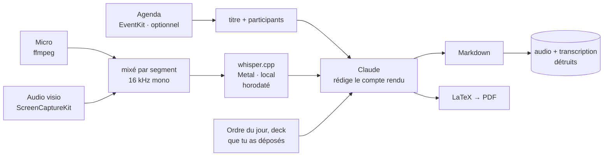

<h1 align="center">Mispy</h1>

<p align="center">
  <strong>Deux commandes. Tu as le compte rendu.</strong><br>
  <sub>Il enregistre la réunion, la transcrit sur ton Mac, et rédige ce qui a été
  décidé et qui doit quoi à qui.</sub>
</p>

<p align="center">
  <a href="#installation">Installation</a> ·
  <a href="#réglage-cinq-minutes-une-fois">Réglage</a> ·
  <a href="#une-réunion-de-bout-en-bout">Déroulé</a> ·
  <a href="#la-salle-la-visio-ou-les-deux">Visios</a> ·
  <a href="#ce-qui-sort-de-ton-mac">Confidentialité</a> ·
  <a href="README.md">🇬🇧 In English</a>
</p>

<p align="center">
  
</p>

---

## L'idée

Tu peux être dans la réunion, ou tu peux prendre les notes. Faire correctement les
deux est un mythe, et celui qui prend les notes est celui qui arrête de contribuer.

```bash
mispy start        # au début
mispy stop         # à la fin
```

C'est toute l'interface. Mispy enregistre — la salle, la visio, ou les deux — et
quand tu l'arrêtes il transcrit l'audio **sur ton Mac**, établit ce qui a été
décidé et qui s'est engagé à quoi, et écrit le tout dans ton dossier de réunions :
un fichier Markdown à coller directement dans Slack ou un mail, et un PDF à garder.

Ensuite il détruit l'enregistrement et la transcription.

---

## Ce que ça donne

Vraie sortie, sur une réunion inventée de trois minutes à propos d'une migration :

```markdown
# Retard migration, budget T4, recrutement

**08/10/2026 · 10:00–10:01 · 2 min**
**Présents :** Jacques Morel, Sandy Lefèvre, Eddy Bertin

## Décisions
- La reprise sera découpée en trois lots, exécutés les nuits du mardi
  au jeudi de la semaine suivante [00:00:26]
- Le contrat du deuxième prestataire sera arrêté fin novembre [00:01:09]

## Actions
| Qui   | Quoi                                              | Pour quand   |
|-------|---------------------------------------------------|--------------|
| Sandy | préparer le plan de bascule et l'envoyer          | vendredi     |
| Eddy  | prévenir le support et rédiger le message client  | mercredi     |
| —     | arrêter le contrat du deuxième prestataire        | fin novembre |
```

Regarde la troisième ligne. Dans l'enregistrement, quelqu'un a dit « je m'en
occupe » et le nom n'était pas audible. Mispy a laissé la colonne vide plutôt que
de deviner. C'est la règle autour de laquelle il est construit : **une action sans
nom est juste ; une action attribuée au mauvais est un problème au bureau.**

Les sections sont toujours les mêmes — résumé, décisions, actions, discussion,
questions ouvertes, ce que personne ne porte encore — et chaque décision porte
l'horodatage du moment où elle a été prise, donc un désaccord sur ce qui a été
acté se règle en trente secondes.

---

## Avant d'enregistrer quoi que ce soit

> Enregistrer des personnes qui n'en ont pas été informées est un **délit** dans un
> certain nombre de pays, dont la France, quel que soit l'usage prévu. Dans la
> plupart des entreprises c'est en outre une faute disciplinaire à part entière,
> indépendamment de la loi.
>
> Mispy ne peut pas savoir qui est dans tes réunions ni ce que ton employeur
> autorise. Dire en début de séance que tu enregistres, et laisser quiconque s'y
> opposer, c'est à toi de le faire. Ça prend une phrase.

C'est aussi pour ça que Mispy n'a aucun démarrage automatique. Son grand frère
[Kispy](https://github.com/Manceff/kispy), qui fait les cours, ouvre le micro tout
seul à l'heure de l'amphi. Mispy ne le fait jamais. Tu appuies sur start,
délibérément, après l'avoir dit à voix haute.

---

## Ce qu'il te faut

| | |
|---|---|
| **Un Mac** | Apple Silicon de préférence — la transcription tourne sur le GPU. macOS 13+ pour l'audio des visios ; le micro marche sur tout. |
| **Un abonnement Claude** | Pro ou Max. Les comptes rendus sont rédigés par Claude via le CLI Claude Code, sur *ton* compte. Mispy ne demande jamais de clé d'API et ne stocke aucun identifiant. |
| **4 Go de libre environ** | dont 3,1 Go pour le modèle de reconnaissance vocale, qui reste sur ta machine. |
| **Homebrew** | [brew.sh](https://brew.sh) — l'installeur s'en sert pour ffmpeg et tectonic. |

Tu as déjà [Kispy](https://github.com/Manceff/kispy) ? L'installeur s'en aperçoit
et réutilise son moteur et ses modèles — pas de second téléchargement de trois
gigaoctets.

---

## Installation

```bash
git clone https://github.com/Manceff/mispy.git
cd mispy
./install.sh
```

Tout atterrit dans ton dossier personnel. Pas de `sudo`, rien en dehors, et
`./uninstall.sh` enlève exactement ce qui a été posé.

---

## Réglage : cinq minutes, une fois

```bash
mispy setup
```

Cinq questions, et rien qu'il aurait pu deviner tout seul.

**1 — Claude.** Il vérifie si le CLI est installé et connecté, propose de
l'installer sinon, et te dit exactement quoi taper si tu n'es pas connecté. Il ne
te demande jamais de clé.

**2 — Comment tu te réunis.** En salle, en visio, ou les deux. C'est ce qui décide
de ce qui est capté — voir plus bas.

**3 — Quel micro.** Par nom, jamais par numéro : les index AVFoundation se
décalent dès qu'un iPhone ou des AirPods apparaissent — c'est comme ça qu'une
réunion finit enregistrée par un téléphone au fond d'une poche. Il enregistre
ensuite quatre secondes et te montre le niveau, ce qui déclenche au passage
l'autorisation micro de macOS.

**4 — Où vont les comptes rendus**, dans quelle langue les rédiger, et à quel
niveau de détail. Il demande aussi si tu veux garder la transcription ; par
défaut, non.

**5 — Ton agenda**, en option. Si Mispy peut le lire, une réunion se nomme toute
seule et arrive avec sa liste de participants déjà remplie — ce qui fait la
différence entre « quelqu'un enverra le deck » et « Alice enverra le deck ».

---

## La salle, la visio, ou les deux

C'est la partie qui compte, et celle que la plupart des outils ratent.

| | Ce qui est capté | Quand l'utiliser |
|---|---|---|
| **mic** | Ton micro | Tout le monde est autour d'une table |
| **system** | Ce que ton Mac joue | Une visio que tu ne fais qu'écouter |
| **both** | Les deux, mixés en une piste | **Une visio où tu parles aussi** — le cas normal |

Ton micro t'entend, toi et la salle. En visio avec un casque, c'est *uniquement
toi* : toutes les autres voix sortent des haut-parleurs et n'atteignent jamais le
micro. `both` enregistre les deux séparément et les mixe segment par segment, pour
que tout le monde soit dans la transcription.

L'audio des visios passe par **ScreenCaptureKit** — aucun périphérique audio
virtuel à installer, pas de Configuration audio et MIDI, pas de redémarrage. macOS
range cette autorisation sous *Enregistrement de l'écran*, c'est donc ce nom que tu
verras dans la boîte de dialogue. Rien de l'écran n'est capturé : le flux est
configuré sur deux pixels de large et seul son son est lu.

> macOS ne demande qu'une fois. Si tu refuses, il ne redemandera pas : Réglages
> Système ▸ Confidentialité et sécurité ▸ Enregistrement de l'écran et du son,
> active ton terminal, puis **quitte-le et rouvre-le**. `mispy doctor` te dit où
> tu en es.

---

## Une réunion, de bout en bout

| | |
|---|---|
| **tu dis** | « J'enregistre pour faire le compte rendu — dites-moi si ça pose un problème. » |
| **tu tapes** | `mispy start` — ou `mispy start "Point hebdo"` si ton agenda ne la connaît pas |
| **pendant** | Rien. Garde l'écran ouvert : si le Mac s'endort, le micro meurt avec lui. `mispy pause` si tu sors. |
| **à la fin** | `mispy stop`. Une boîte de dialogue demande qui était là, pré-remplie depuis ton agenda. |
| **quelques minutes après** | Une notification. `mispy last` l'ouvre. |

Transcrire une heure de réunion prend environ sept minutes sur un Mac Apple
Silicon, la rédaction une de plus. Tu peux refermer l'écran pendant ce temps : ça
reprend au réveil.

<p align="center">
  
</p>

---

## Les commandes

| | |
|---|---|
| `mispy` | L'app : un écran, cinq touches. |
| `mispy start` / `mispy start "Nom"` | Démarrer. Se nomme depuis ton agenda si tu l'autorises. |
| `mispy stop` | Terminer, et rédiger le compte rendu. |
| `mispy pause` | Pause ; `mispy start` reprend sur un nouveau segment. |
| `mispy discard` | Jeter l'enregistrement, ne rien garder. Pour un test, ou une conversation qui n'aurait finalement pas dû être enregistrée. |
| `mispy status` | Ce qu'il fait en ce moment. Texte brut, pratique en SSH. |
| `mispy last` | Ouvre le dernier compte rendu. |
| `mispy setup` / `mispy doctor` / `mispy test` | Configurer, vérifier, et prouver que la chaîne marche en huit secondes. |

---

## La meilleure chose que tu puisses faire

```bash
open ~/.config/mispy/glossary.txt
```

Mets-y les noms de tes collègues, tes produits, tes clients et tes acronymes
internes, un par ligne. Ils sont donnés au modèle de reconnaissance comme
contexte, et c'est là que les erreurs d'écoute sont *empêchées* — les corriger
après coup relève de la devinette, et dans un compte rendu un nom faux est pire
qu'un nom absent.

Sans ça, « la migration Postgres » revient en « la migration poste », et tout ce
qui s'écrit ensuite repose là-dessus.

---

## Ce qui sort de ton Mac

**L'enregistrement, jamais.** La reconnaissance vocale tourne en local via
whisper.cpp sur ton GPU. Aucun fichier audio n'est envoyé à qui que ce soit.

**Le texte, oui.** La transcription — et le texte de ce que tu as déposé dans le
dossier de la réunion — est envoyée à Claude, parce que c'est ce qui rédige le
compte rendu. Sur ton propre abonnement, via le CLI Claude Code. Rien d'autre ne
part avec : ni ton agenda, ni tes autres réunions, ni tes noms de fichiers.

**Les deux sont détruits** dès que le compte rendu existe : les segments audio, la
piste mixée et la transcription, écrasés puis supprimés. Mets
`keep_transcript = true` dans la configuration si tu as besoin de pouvoir revenir
à ce qui a été dit. Si la chaîne *échoue*, l'audio est au contraire conservé pour
pouvoir recommencer — c'est le seul cas où du son survit sur le disque.

**Aucun identifiant.** Mispy ne demande jamais de mot de passe ni de clé d'API et
n'en stocke aucun. Il appelle `claude`, qui gère la connexion lui-même.

---

## Quand ça cloche

Commence par `mispy doctor`.

| Symptôme | Ce qui se passe | Solution |
|---|---|---|
| Il n'y a que ma voix dans le compte rendu | Tu es en visio avec un casque et tu n'enregistres que le micro | `mispy setup`, choisis *en visio* — ou mets `capture = "both"` |
| L'audio système échoue au réglage | L'enregistrement de l'écran n'est pas autorisé pour ton terminal | Réglages Système ▸ Confidentialité et sécurité ▸ Enregistrement de l'écran et du son, active ton terminal, **quitte-le et rouvre-le** |
| Rien n'a été enregistré du tout | Pas d'autorisation micro | Réglages Système ▸ Confidentialité et sécurité ▸ Microphone, autorise ton terminal, puis `mispy test` |
| Il a enregistré par mon iPhone | Une entrée est apparue et a décalé les index | Déjà traité — Mispy sélectionne par nom. Si le nom a changé, relance `mispy setup` |
| Il s'est arrêté au milieu | L'écran a été rabattu. Sur Apple Silicon ça force la veille et rien ne peut l'empêcher | Garde l'écran ouvert ; `mispy start` repart sur un nouveau segment et les deux sont recollés |
| Les noms sont massacrés | Le modèle ignorait que c'étaient des noms | `~/.config/mispy/glossary.txt` |
| Tout est attribué à la même personne | Mispy ne sépare pas les locuteurs — voir ci-dessous | Dis les prénoms à voix haute, et donne-lui la liste des participants |
| Pas de PDF, juste du Markdown | tectonic n'est pas installé | `brew install tectonic` |

**Sur « qui a dit quoi ».** Mispy ne distingue pas les voix. Le compte rendu
attribue une action quand un prénom a été prononcé, ou quand la liste des
participants ne laisse aucun doute, et laisse vide sinon. C'est une limite
assumée, pas un oubli : dans un compte rendu, une attribution plausible mais
fausse fait plus de dégâts qu'une case vide.

---

## Comment ça marche



Quelques décisions qui ne vont pas de soi :

- **Deux enregistreurs, mixés par segment et non par piste.** Ils ne démarrent pas
  à la même milliseconde ; mixer des pistes entières empilerait cette erreur sur
  toute une réunion de deux heures.
- **La transcription garde les horodatages.** Un compte rendu sans eux est
  invérifiable.
- **Le Markdown est le livrable, le PDF est un bonus.** Si la composition échoue,
  le travail réussit quand même et tu as ton compte rendu.
- **Le travail vit dans un fichier JSON**, écrit atomiquement, et chaque étape
  vérifie si sa propre sortie existe déjà — donc une réunion interrompue par un
  écran rabattu reprend où elle s'était arrêtée.
- **Rien n'est déduit.** Le prompt interdit d'ajouter une décision, un chiffre ou
  une échéance au motif qu'une réunion de ce type en comporte d'habitude.

Plus de détails dans [docs/how-it-works.md](docs/how-it-works.md).

---

## Questions

**Ça marche avec Teams / Zoom / Meet / les huddles Slack ?** Oui — il enregistre
ce que ton Mac joue, quel que soit ce qui le joue.

**Ça coûte combien ?** Rien de plus que l'abonnement Claude que tu as déjà. La
transcription est locale et gratuite.

**En anglais, en allemand, en espagnol ?** Oui — tu règles la langue parlée au
setup, et le compte rendu est rédigé dans la même langue sauf si tu demandes
autre chose.

**Je peux changer la structure du compte rendu ?** Les sections sont définies dans
`RULES`, dans `mispy/minutes.py` ; le PDF est un seul fichier LaTeX,
`style/minutes.tex`.

**Il y a un démarrage automatique ?** Non, volontairement. Voir
[plus haut](#avant-denregistrer-quoi-que-ce-soit).

**Où je signale un problème ?**
[Issues](https://github.com/Manceff/mispy/issues).

---

## Licence

MIT. Voir [LICENSE](LICENSE).

Projet frère : [Kispy](https://github.com/Manceff/kispy), la même idée pour les
cours. Construit sur [whisper.cpp](https://github.com/ggml-org/whisper.cpp),
[tectonic](https://tectonic-typesetting.github.io),
[rich](https://github.com/Textualize/rich) et
[Claude Code](https://claude.com/claude-code).
