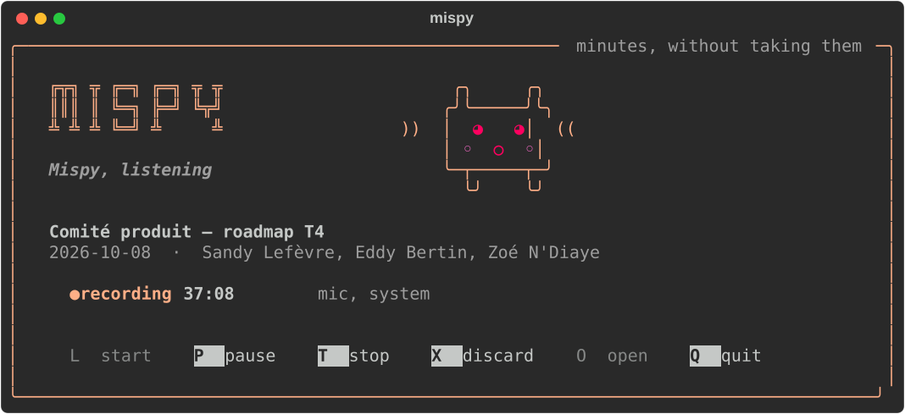
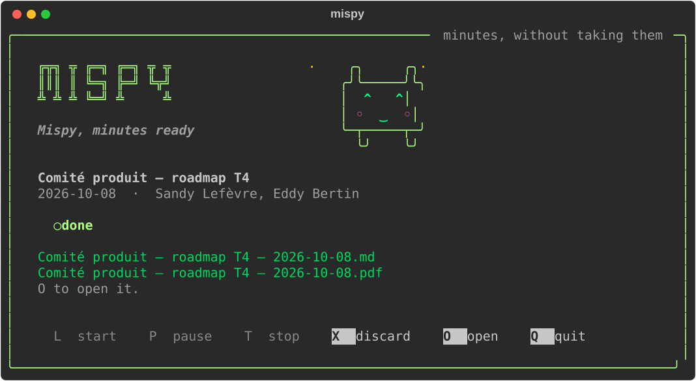
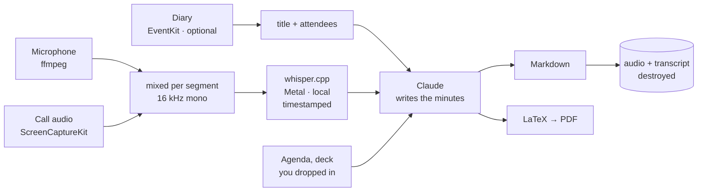

<h1 align="center">Mispy</h1>

<p align="center">
  <strong>Two commands. You get the minutes.</strong><br>
  <sub>Records the meeting, transcribes it on your own Mac, and writes up what was
  decided and who owes what to whom.</sub>
</p>

<p align="center">
  <a href="#install">Install</a> ·
  <a href="#setup-five-minutes-once">Setup</a> ·
  <a href="#a-meeting-end-to-end">How it goes</a> ·
  <a href="#the-room-the-call-or-both">Calls</a> ·
  <a href="#what-leaves-your-mac">Privacy</a> ·
  <a href="README.fr.md">🇫🇷 En français</a>
</p>

<p align="center">
  
</p>

---

## The idea

You can be in the meeting or you can take the notes. Doing both well is a myth,
and the person taking the notes is the one who stops contributing.

```bash
mispy start        # as it begins
mispy stop         # as it ends
```

That is the whole interface. Mispy records — the room, the call, or both — and
when you stop it transcribes the audio **on your Mac**, works out what was
decided and who committed to what, and writes it into your meetings folder as a
Markdown file you can paste straight into Slack or an email, and a PDF you can
keep.

Then it destroys the recording and the transcript.

---

## What comes out

Real output, from a (made-up) three-minute meeting about a database migration:

```markdown
# Retard migration, budget T4, recrutement

**08/10/2026 · 10:00–10:01 · 2 min**
**Présents :** Jacques Morel, Sandy Lefèvre, Eddy Bertin

## Décisions
- La reprise sera découpée en trois lots, exécutés les nuits du mardi
  au jeudi de la semaine suivante [00:00:26]
- Le contrat du deuxième prestataire sera arrêté fin novembre [00:01:09]

## Actions
| Qui   | Quoi                                              | Pour quand   |
|-------|---------------------------------------------------|--------------|
| Sandy | préparer le plan de bascule et l'envoyer          | vendredi     |
| Eddy  | prévenir le support et rédiger le message client  | mercredi     |
| —     | arrêter le contrat du deuxième prestataire        | fin novembre |
```

Note the third row. In the recording, somebody said *"I'll take care of it"* and
the name was not audible. Mispy left the owner blank rather than guessing. That
is the rule it is built around: **an unattributed action is correct, a wrongly
attributed one is a problem at work.**

The sections are always the same — summary, decisions, actions, discussion, open
questions, what has no owner yet — and each decision carries the timestamp where
it was taken, so an argument about what was agreed takes thirty seconds to settle.

---

## Before you record anything

> Recording people who have not been told is a **criminal offence** in a number of
> countries, France among them, whatever you intend to use the recording for. In
> most workplaces it is a disciplinary matter in its own right, quite apart from
> the law.
>
> Mispy cannot know who is in your meetings or what your employer allows. Saying
> at the start that you are recording, and letting anyone object, is yours to do.
> It takes one sentence.

This is also why Mispy has no automatic start. Its sibling
[Kispy](https://github.com/Manceff/kispy), which does lectures, opens the
microphone by itself when a class begins. Mispy never does. You press start,
deliberately, having said so out loud.

---

## What you need

| | |
|---|---|
| **A Mac** | Apple Silicon preferred — transcription runs on the GPU. macOS 13+ for call audio; the microphone works on anything. |
| **A Claude subscription** | Pro or Max. The minutes are written by Claude through the Claude Code CLI, on *your* account. Mispy never asks for an API key and never stores a credential. |
| **About 4 GB free** | 3.1 GB of it is the speech model, which stays on your machine. |
| **Homebrew** | [brew.sh](https://brew.sh) — the installer uses it for ffmpeg and tectonic. |

Already running [Kispy](https://github.com/Manceff/kispy)? The installer notices
and reuses its speech engine and models — no second three-gigabyte download.

---

## Install

```bash
git clone https://github.com/Manceff/mispy.git
cd mispy
./install.sh
```

Everything lands under your home directory. No `sudo`, nothing touched outside
it, and `./uninstall.sh` removes exactly what was put there.

---

## Setup: five minutes, once

```bash
mispy setup
```

It asks five things, and nothing it could have worked out on its own.

**1 — Claude.** It checks whether the CLI is installed and signed in, offers to
install it if not, and tells you exactly what to type if you are not signed in.
It never asks you for a key.

**2 — How you meet.** The room, calls, or both. This decides what gets recorded —
see below.

**3 — Which microphone.** By name, never by number: AVFoundation indices shift the
moment an iPhone or a pair of AirPods appears nearby, and that is how a meeting
ends up recorded through a phone in somebody's pocket. It then records four
seconds and shows you the level, which is also what triggers the macOS
microphone permission.

**4 — Where the minutes go**, which language to write them in, and how much
detail you want. It also asks whether to keep the transcript; by default it does
not.

**5 — Your diary**, optionally. If Mispy can read your calendar, a meeting names
itself and arrives with its attendee list already filled in — which is the
difference between *"someone will send the deck"* and *"Alice will send the deck"*.

---

## The room, the call, or both

This is the part that matters, and the part most tools get wrong.

| | What it records | When to use it |
|---|---|---|
| **mic** | Your microphone | Everyone is around a table |
| **system** | What your Mac is playing | A call you are only listening to |
| **both** | The two, mixed into one track | **A call you are also speaking in** — the usual case |

Your own microphone hears you and the room. On a call with headphones on, that is
*only you*: every other voice is coming out of the speakers and never reaches the
microphone. `both` records the two separately and mixes them per segment, so the
transcript has everybody in it.

Call audio goes through **ScreenCaptureKit** — there is no virtual audio device to
install, no Audio MIDI Setup, no reboot. macOS files that permission under
*Screen Recording*, so that is the name you will see in the dialog. Nothing from
the screen is captured: the stream is configured at two pixels wide and only its
sound is read.

> macOS asks only once. If you refuse, it will not ask again: System Settings ▸
> Privacy & Security ▸ Screen & System Audio Recording, switch on your terminal,
> then quit and reopen it. `mispy doctor` tells you where you stand.

---

## A meeting, end to end

| | |
|---|---|
| **you say** | "I'm recording this so I can write it up — say if you'd rather I didn't." |
| **you type** | `mispy start` — or `mispy start "Weekly ops"` if your diary does not know about it |
| **during** | Nothing. Keep the lid open: if the Mac sleeps the microphone dies with it. `mispy pause` if you step out. |
| **at the end** | `mispy stop`. One dialog asks who was there, prefilled from your diary. |
| **a few minutes later** | A notification. `mispy last` opens it. |

Transcription of an hour's meeting takes about seven minutes on an M-series Mac,
writing the minutes about one. You can close the lid while it works; it resumes
on wake.

<p align="center">
  
</p>

---

## Commands

| | |
|---|---|
| `mispy` | The app: one screen, five keys. |
| `mispy start` / `mispy start "Name"` | Begin. Names itself from your diary if you let it. |
| `mispy stop` | End, and write the minutes. |
| `mispy pause` | Pause; `mispy start` resumes on a new segment. |
| `mispy discard` | Throw the recording away and keep nothing. For a test, or a conversation that should not have been recorded after all. |
| `mispy status` | What it is doing right now. Plain text, useful over SSH. |
| `mispy last` | Open the minutes it wrote last. |
| `mispy setup` / `mispy doctor` / `mispy test` | Configure, check, and prove the chain works in eight seconds. |

---

## The single best thing you can do

```bash
open ~/.config/mispy/glossary.txt
```

Put your colleagues' names, your products, your clients and your internal
acronyms in there, one per line. They are fed to the speech recogniser as
context, and that is where mishearings are *prevented* — correcting them
afterwards is guesswork, and in minutes a wrong name is worse than no name.

Without it, "the Postgres migration" comes back as "the postal migration", and
everything written from that point rests on it.

---

## What leaves your Mac

**The recording never does.** Speech recognition runs locally through whisper.cpp
on your GPU. No audio file is uploaded, to anyone, ever.

**The text does.** The transcript — and the text of anything you dropped in the
meeting folder — is sent to Claude, because that is what writes the minutes. On
your own subscription, through the Claude Code CLI. Nothing else goes with it:
not your calendar, not your other meetings, not your file names.

**Both are destroyed** as soon as the minutes exist: the audio segments, the
mixed track and the transcript, overwritten and unlinked. Set
`keep_transcript = true` in the config if you need to be able to go back to what
was actually said. If the pipeline *fails*, the audio is kept instead, so you can
run it again — that is the one case where sound survives on disk.

**No credentials.** Mispy never asks for a password or an API key and never
stores one. It shells out to `claude`, which handles your sign-in itself.

---

## When something goes wrong

Start with `mispy doctor`.

| Symptom | What is happening | Fix |
|---|---|---|
| Only my own voice is in the minutes | You are on a call with headphones and recording the microphone alone | `mispy setup`, choose *on calls* — or set `capture = "both"` |
| `system audio` fails at setup | Screen recording is not permitted for your terminal | System Settings ▸ Privacy & Security ▸ Screen & System Audio Recording, switch on your terminal, **quit and reopen it** |
| Nothing was recorded at all | No microphone permission | System Settings ▸ Privacy & Security ▸ Microphone, allow your terminal, then `mispy test` |
| It recorded through my iPhone | An input appeared and shifted the indices | Already handled — Mispy matches by name. If the name changed, re-run `mispy setup` |
| It stopped halfway | The lid was closed. On Apple Silicon that forces sleep and nothing can prevent it | Keep the lid open; `mispy start` resumes on a new segment and the two are joined |
| Names are mangled | The recogniser had no idea they were names | `~/.config/mispy/glossary.txt` |
| Everyone's words are attributed to one person | Mispy does not do speaker diarisation — see below | Say names out loud, and give it the attendee list |
| No PDF, only Markdown | tectonic is not installed | `brew install tectonic` |

**On who said what.** Mispy does not separate speakers by voice. The minutes
attribute an action to someone when a name was spoken, or when the attendee list
leaves no doubt, and leave it blank otherwise. That is a deliberate limit, not an
oversight: a plausible wrong attribution in minutes causes more damage than a
blank.

---

## How it works



A few decisions worth knowing about:

- **Two recorders, mixed per segment, not per track.** They do not start on the
  same millisecond; mixing whole tracks would stack that error across a two-hour
  meeting.
- **The transcript keeps timestamps.** Minutes without them are unverifiable.
- **Markdown is the deliverable, the PDF is a bonus.** If typesetting fails the
  job still succeeds and you still have your minutes.
- **The job lives in a JSON file**, written atomically, and every stage checks
  whether its own output already exists — so a meeting interrupted by a closing
  lid resumes where it stopped instead of starting over.
- **Nothing is inferred.** The prompt forbids adding a decision, a figure or a
  deadline because a meeting like this usually has one.

More in [docs/how-it-works.md](docs/how-it-works.md).

---

## Questions

**Does it work with Teams / Zoom / Meet / Slack huddles?** Yes — it records what
your Mac is playing, whatever is playing it.

**What does it cost?** Nothing beyond the Claude subscription you already have.
Transcription is local and free.

**Can I use it in English, German, Spanish?** Yes — you set the spoken language at
setup, and the minutes are written in the same language unless you ask otherwise.

**Can I change the shape of the minutes?** The sections are defined in `RULES` in
`mispy/minutes.py`; the PDF is one LaTeX file in `style/minutes.tex`.

**Is there an auto-start?** No, by design. See
[above](#before-you-record-anything).

**Where do I report something?**
[Issues](https://github.com/Manceff/mispy/issues).

---

## Licence

MIT. See [LICENSE](LICENSE).

Sibling project: [Kispy](https://github.com/Manceff/kispy), the same idea for
lectures. Built on [whisper.cpp](https://github.com/ggml-org/whisper.cpp),
[tectonic](https://tectonic-typesetting.github.io),
[rich](https://github.com/Textualize/rich) and
[Claude Code](https://claude.com/claude-code).
