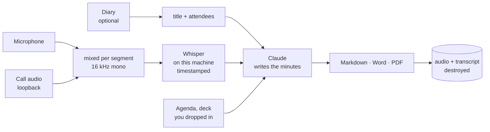

<h1 align="center">Mispy</h1>

<p align="center">
  <strong>Two commands. You get the minutes.</strong><br>
  <sub>Records the meeting, transcribes it on your own machine, and writes up what
  was decided and who owes what to whom. <b>macOS and Windows.</b></sub>
</p>

<p align="center">
  <a href="#install">Install</a> ·
  <a href="#setup-five-minutes-once">Setup</a> ·
  <a href="#a-meeting-end-to-end">How it goes</a> ·
  <a href="#the-room-the-call-or-both">Calls</a> ·
  <a href="#at-work-on-a-locked-down-pc">At work</a> ·
  <a href="#what-leaves-your-machine">Privacy</a> ·
  <a href="README.fr.md">🇫🇷 En français</a>
</p>

<p align="center">
  
</p>

---

## The idea

You can be in the meeting or you can take the notes. Doing both well is a myth,
and the person taking the notes is the one who stops contributing.

```bash
mispy start        # as it begins
mispy stop         # as it ends
```

That is the whole interface. Mispy records — the room, the call, or both — and
when you stop it transcribes the audio **on your own machine**, works out what was
decided and who committed to what, and writes it into your meetings folder:
Markdown to paste into Slack or an email, a Word file to forward, a PDF to keep.
You choose which.

Then it destroys the recording and the transcript.

---

## What comes out

Real output, from a (made-up) three-minute meeting about a database migration:

```markdown
# Retard migration, budget T4, recrutement

**08/10/2026 · 10:00–10:01 · 2 min**
**Présents :** Jacques Morel, Sandy Lefèvre, Eddy Bertin

## Décisions
- La reprise sera découpée en trois lots, exécutés les nuits du mardi
  au jeudi de la semaine suivante [00:00:26]
- Le contrat du deuxième prestataire sera arrêté fin novembre [00:01:09]

## Actions
| Qui   | Quoi                                              | Pour quand   |
|-------|---------------------------------------------------|--------------|
| Sandy | préparer le plan de bascule et l'envoyer          | vendredi     |
| Eddy  | prévenir le support et rédiger le message client  | mercredi     |
| —     | arrêter le contrat du deuxième prestataire        | fin novembre |
```

Note the third row. In the recording, somebody said *"I'll take care of it"* and
the name was not audible. Mispy left the owner blank rather than guessing. That
is the rule it is built around: **an unattributed action is correct, a wrongly
attributed one is a problem at work.**

The sections are always the same — summary, decisions, actions, discussion, open
questions, what has no owner yet — and each decision carries the timestamp where
it was taken, so an argument about what was agreed takes thirty seconds to settle.

---

## Before you record anything

> Recording people who have not been told is a **criminal offence** in a number of
> countries, France among them, whatever you intend to use the recording for. In
> most workplaces it is a disciplinary matter in its own right, quite apart from
> the law.
>
> Mispy cannot know who is in your meetings or what your employer allows. Saying
> at the start that you are recording, and letting anyone object, is yours to do.
> It takes one sentence.

This is also why Mispy has no automatic start. Its sibling
[Kispy](https://github.com/Manceff/kispy), which does lectures, opens the
microphone by itself when a class begins. Mispy never does. You press start,
deliberately, having said so out loud.

---

## What you need

| | |
|---|---|
| **A Mac or a Windows PC** | macOS 13+ (Apple Silicon preferred — transcription runs on the GPU), or Windows 10/11. |
| **A Claude subscription** | Pro or Max, or a Claude Code licence from your employer. The minutes are written by Claude through the Claude Code CLI, on *your* account. Mispy never asks for an API key and never stores a credential. |
| **2 to 4 GB free** | Most of it is the speech model, which stays on your machine and never phones home. |
| **Python 3.11+** | The installer finds it, or installs it for your user only. |

Nothing else. In particular: no admin rights, no driver, no virtual audio cable,
no Teams plugin, nothing registered with your company's Azure AD.

---

## Install

**macOS**

```bash
git clone https://github.com/Manceff/mispy.git
cd mispy
./install.sh
```

Uses Homebrew for ffmpeg and tectonic. Already running
[Kispy](https://github.com/Manceff/kispy)? The installer notices and reuses its
speech engine and models — no second three-gigabyte download.

**Windows**

```powershell
git clone https://github.com/Manceff/mispy.git
cd mispy
powershell -ExecutionPolicy Bypass -File .\install.ps1
```

Everything lands under `%LOCALAPPDATA%\Mispy`. **No administrator rights are
needed** — if Python is missing it is installed for your user only. Then open a
*new* terminal so the `mispy` command is on your PATH.

On both, `uninstall` removes exactly what was put there and never touches your
minutes.

---

## Setup: five minutes, once

```bash
mispy setup
```

It asks five things, and nothing it could have worked out on its own.

**1 — Claude.** It checks whether the CLI is installed and signed in, offers to
install it if not, and tells you exactly what to type if you are not signed in.
It never asks you for a key.

**2 — How you meet.** The room, calls, or both. This decides what gets recorded —
see below.

**3 — Which microphone**, and on Windows which output the call comes through —
your headset if you wear one. Both by name, never by number: the order shifts the
moment a headset or a phone appears, and that is how a meeting ends up recorded
through the wrong thing. It then records four seconds and shows you the level,
which is also what triggers the operating system's microphone permission.

**4 — Where the minutes go**, which files you want (Markdown, Word, PDF), which
language to write them in, and how much detail. It also asks whether to keep the
transcript; by default it does not.

**5 — Your diary**, optionally — the Calendar app on a Mac, Outlook on a PC. If
Mispy can read it, a meeting names itself and arrives with its attendee list
already filled in, which is the difference between *"someone will send the deck"*
and *"Alice will send the deck"*.

---

## The room, the call, or both

This is the part that matters, and the part most tools get wrong.

| | What it records | When to use it |
|---|---|---|
| **mic** | Your microphone | Everyone is around a table |
| **system** | What your machine is playing | A call you are only listening to |
| **both** | The two, mixed into one track | **A call you are also speaking in** — the usual case |

Your own microphone hears you and the room. On a call with headphones on, that is
*only you*: every other voice is coming out of the speakers and never reaches the
microphone. `both` records the two separately and mixes them per segment, so the
transcript has everybody in it.

How the call audio is captured depends on the machine, and neither way needs
anything installed:

- **Windows** — WASAPI loopback. Windows hands the sound of a call to any
  program running as you that asks for it. No VB-Cable, no VoiceMeeter, no
  Stereo Mix, no reboot.
- **macOS** — ScreenCaptureKit. macOS files that permission under *Screen
  Recording*, so that is the name you will see in the dialog. Nothing from the
  screen is captured: the stream is two pixels wide and only its sound is read.
  macOS asks only once; if you refuse, System Settings ▸ Privacy & Security ▸
  Screen & System Audio Recording, then quit and reopen your terminal.

`mispy doctor` tells you where you stand on either.

---

## At work, on a locked-down PC

Most of what a company blocks, Mispy never asks for.

**It does not touch Teams.** A Teams meeting is sound coming out of your
speakers and an appointment in your Outlook calendar. Mispy records the sound and
reads the appointment. There is no Teams app to install, no bot to admit into the
meeting, no tenant setting to change — and nothing that shows up as a recording
indicator to the other participants, which is exactly why **saying out loud that
you are recording is not optional**. See [above](#before-you-record-anything).

**It reads your diary through Outlook itself, over COM.** Not the Graph API:
Graph needs an application registered in Azure AD and, in most companies, an
administrator to consent to it — the door that is shut on a locked-down machine.
Classic Outlook is already running and already signed in as you, and it will
answer questions about your calendar without anyone's permission but yours. From
it, Mispy takes the meeting's title and its attendee list, which is the
difference between *"someone will send the deck"* and *"Alice will send the
deck"*.

> If your company has moved you to the **new** Outlook, COM is not available.
> Switch the toggle back to classic, or turn the diary off and name meetings
> yourself: `mispy start "Weekly ops"`. Everything else works the same.

**The transcription runs on the PC.** No audio is uploaded anywhere, by anyone.
On Windows that is [faster-whisper](https://github.com/SYSTRAN/faster-whisper) —
a pip install, no compiler, no Visual Studio, no admin.

**Nothing needs admin rights.** Python goes in for your user only, the program
lives in `%LOCALAPPDATA%`, and the only thing added to the system is one entry on
*your* PATH.

The one thing you do need is Claude Code, signed in. You said you have it.

---

## A meeting, end to end

| | |
|---|---|
| **you say** | "I'm recording this so I can write it up — say if you'd rather I didn't." |
| **you type** | `mispy start` — or `mispy start "Weekly ops"` if your diary does not know about it |
| **during** | Nothing. Keep the lid open: if the machine sleeps the microphone dies with it. `mispy pause` if you step out. |
| **at the end** | `mispy stop`. One dialog asks who was there, prefilled from your diary. |
| **a few minutes later** | A notification. `mispy last` opens it. |

Transcription of an hour's meeting takes about seven minutes on an M-series Mac
and ten to twenty on a work laptop's CPU; writing the minutes takes about one. You can close the lid while it works; it resumes
on wake.

<p align="center">
  
</p>

---

## The button in your menu bar

The terminal is fine for setting the thing up once. It is not fine for starting a
recording between two meetings. `Mispy.app` puts a single dot in your menu bar:

```
●  Mispy — Enregistre
   Comité produit
   ─────────────────────────────
   Terminer et rédiger        ⌘S
   Mettre en pause
   Supprimer la prise
   ─────────────────────────────
   Ouvrir le dernier compte rendu
   Ouvrir le dossier des réunions
```

The dot tells you the state at a glance — a microphone when idle, a red record
circle with the elapsed time while recording, a pencil while the minutes are being
written, a tick when they are ready. It does nothing itself: it reads Mispy's state
file and calls the same `mispy` command you would have typed.

The installer builds it. Open it once from `~/Applications`, and add it to your
login items if you want it there every morning.

> macOS attributes permissions to the application that asks, so the first
> recording started from the menu bar asks for the microphone again, even if you
> had already allowed your terminal. Once, then never again.

---

## Commands

| | |
|---|---|
| `mispy` | The app: one screen, five keys. |
| `mispy start` / `mispy start "Name"` | Begin. Names itself from your diary if you let it. |
| `mispy stop` | End, and write the minutes. |
| `mispy pause` | Pause; `mispy start` resumes on a new segment. |
| `mispy discard` | Throw the recording away and keep nothing. For a test, or a conversation that should not have been recorded after all. |
| `mispy status` | What it is doing right now. Plain text, useful over SSH. |
| `mispy last` | Open the minutes it wrote last. |
| `mispy setup` / `mispy doctor` / `mispy test` | Configure, check, and prove the chain works in eight seconds. |

---

## The single best thing you can do

```bash
open ~/.config/mispy/glossary.txt
```

Put your colleagues' names, your products, your clients and your internal
acronyms in there, one per line. They are fed to the speech recogniser as
context, and that is where mishearings are *prevented* — correcting them
afterwards is guesswork, and in minutes a wrong name is worse than no name.

Without it, "the Postgres migration" comes back as "the postal migration", and
everything written from that point rests on it.

---

## What leaves your machine

**The recording never does.** Speech recognition runs on this machine — whisper.cpp
on a Mac's GPU, faster-whisper on a PC's CPU. No audio file is uploaded, to anyone,
ever.

**The text does.** The transcript — and the text of anything you dropped in the
meeting folder — is sent to Claude, because that is what writes the minutes. On
your own subscription, through the Claude Code CLI. Nothing else goes with it:
not your calendar, not your other meetings, not your file names.

**Both are destroyed** as soon as the minutes exist: the audio segments, the
mixed track and the transcript, overwritten and unlinked. Set
`keep_transcript = true` in the config if you need to be able to go back to what
was actually said. If the pipeline *fails*, the audio is kept instead, so you can
run it again — that is the one case where sound survives on disk.

**No credentials.** Mispy never asks for a password or an API key and never
stores one. It shells out to `claude`, which handles your sign-in itself.

---

## When something goes wrong

Start with `mispy doctor`.

| Symptom | What is happening | Fix |
|---|---|---|
| Only my own voice is in the minutes | You are on a call with headphones and recording the microphone alone | `mispy setup`, choose *on calls* — or set `capture = "both"` |
| `call audio` fails at setup, **macOS** | Screen recording is not permitted for your terminal | System Settings ▸ Privacy & Security ▸ Screen & System Audio Recording, switch on your terminal, **quit and reopen it** |
| `call audio` fails at setup, **Windows** | No output device reports a loopback | Set a default playback device in Windows sound settings, then `mispy setup` again |
| Nothing was recorded at all | No microphone permission | macOS: System Settings ▸ Privacy & Security ▸ Microphone. Windows: Settings ▸ Privacy & security ▸ Microphone, and allow desktop apps. Then `mispy test` |
| `mispy` is not recognised, **Windows** | The PATH entry was added after this terminal opened | Open a new terminal |
| Outlook says nothing is in my diary | You are on the new Outlook, which has no COM interface | Switch to classic Outlook, or name meetings yourself: `mispy start "Weekly"` |
| `pip` cannot reach PyPI, **Windows** | A corporate proxy | `pip config set global.proxy http://your.proxy:port`, or ask IT for the index URL, then re-run install.ps1 |
| It recorded through my iPhone | An input appeared and shifted the indices | Already handled — Mispy matches by name. If the name changed, re-run `mispy setup` |
| It stopped halfway | The lid was closed. On Apple Silicon that forces sleep and nothing can prevent it | Keep the lid open; `mispy start` resumes on a new segment and the two are joined |
| Names are mangled | The recogniser had no idea they were names | `~/.config/mispy/glossary.txt` |
| Everyone's words are attributed to one person | Mispy does not do speaker diarisation — see below | Say names out loud, and give it the attendee list |
| No PDF, only the other formats | tectonic is not installed | macOS: `brew install tectonic`. Windows: `winget install TectonicTypesetting.Tectonic`. Markdown and Word do not need it |

**On who said what.** Mispy does not separate speakers by voice. The minutes
attribute an action to someone when a name was spoken, or when the attendee list
leaves no doubt, and leave it blank otherwise. That is a deliberate limit, not an
oversight: a plausible wrong attribution in minutes causes more damage than a
blank.

---

## How it works



Only the first and the last steps are platform-specific. Everything in between is
the same code:

| | macOS | Windows |
|---|---|---|
| Microphone | ffmpeg (AVFoundation) | WASAPI, through `soundcard` |
| Call audio | ScreenCaptureKit, in a small Swift helper | WASAPI loopback |
| Mixing | ffmpeg | numpy |
| Speech | whisper.cpp on the GPU (Metal) | faster-whisper on the CPU |
| Diary | EventKit, in a small Swift helper | Outlook, over COM |
| Keeping awake | `caffeinate` | `SetThreadExecutionState` |

A few decisions worth knowing about:

- **Two recorders, mixed per segment, not per track.** They do not start on the
  same millisecond; mixing whole tracks would stack that error across a two-hour
  meeting.
- **The engine follows the model, not the machine.** A `.bin` model means
  whisper.cpp, any other name means faster-whisper. Guessing from what happens to
  be installed would make one config file behave differently on two machines.
- **The transcript keeps timestamps.** Minutes without them are unverifiable.
- **Markdown is the deliverable, the PDF is a bonus.** If typesetting fails the
  job still succeeds and you still have your minutes.
- **The job lives in a JSON file**, written atomically, and every stage checks
  whether its own output already exists — so a meeting interrupted by a closing
  lid resumes where it stopped instead of starting over.
- **Nothing is inferred.** The prompt forbids adding a decision, a figure or a
  deadline because a meeting like this usually has one.

More in [docs/how-it-works.md](docs/how-it-works.md).

---

## Questions

**Does it work with Teams / Zoom / Meet / Slack huddles?** Yes — it records what
your machine is playing, whatever is playing it.

**What does it cost?** Nothing beyond the Claude subscription you already have.
Transcription is local and free.

**Can I use it in English, German, Spanish?** Yes — you set the spoken language at
setup, and the minutes are written in the same language unless you ask otherwise.

**Can I change the shape of the minutes?** The sections are defined in `RULES` in
`mispy/minutes.py`; the PDF is one LaTeX file in `style/minutes.tex`.

**Which files do I get?** Whichever you ask for at setup, from `md`, `docx` and
`pdf`. Word is the default on Windows, because at work that is the file people
actually open and forward. Markdown is always written, whatever else fails.

**Does it need a GPU?** No. On a work laptop it runs on the CPU, which is why the
installer suggests `large-v3-turbo` rather than `large-v3` there.

**Is there an auto-start?** No, by design. See
[above](#before-you-record-anything).

**Where do I report something?**
[Issues](https://github.com/Manceff/mispy/issues).

---

## Licence

MIT. See [LICENSE](LICENSE).

Sibling project: [Kispy](https://github.com/Manceff/kispy), the same idea for
lectures. Built on [whisper.cpp](https://github.com/ggml-org/whisper.cpp),
[tectonic](https://tectonic-typesetting.github.io),
[rich](https://github.com/Textualize/rich) and
[Claude Code](https://claude.com/claude-code).
